# Metroid without the slowdown

*NES · Metroid (USA) · stock 128K MMC1 cartridge*

Metroid slows down whenever the screen fills with enemies, and it stalls every time Samus enters a new room. This patch removes almost all of that slowdown. It works on the original cartridge hardware, the same MMC1 board and 128K of program ROM, and apart from the missing slowdown the game plays exactly like the original.

## Playing it

You need your own copy of Metroid (USA) for the NES. The patch contains none of the game; it changes your copy.

1. Download the patch for your copy of the game:
   - [`Metroid (USA) - Lag Fix 1.0 (iNES header).bps`](<Metroid (USA) - Lag Fix 1.0 (iNES header).bps>), for copies with the original iNES header, including No-Intro's `Metroid (USA).nes` and GoodNES's `Metroid (U) (PRG0) [!].nes`
   - [`Metroid (USA) - Lag Fix 1.0 (NES 2.0 header).bps`](<Metroid (USA) - Lag Fix 1.0 (NES 2.0 header).bps>), for copies with the newer NES 2.0 header

   The game is the same in both; they differ only in the 16-byte header at the start of the file, which each keeps as it was. If you're not sure which you have, try the first; the patcher will refuse the wrong one.
2. Apply it to your `.nes` file with a BPS patcher: [Rom Patcher JS](https://www.marcrobledo.com/RomPatcher.js/) works in a browser, or [Flips](https://github.com/Alcaro/Flips) on your computer.
3. Play the patched ROM in any NES emulator, or copy it to a flash cartridge. It uses the same MMC1 board as the original game, so anything that runs Metroid runs this.

You'll know it worked when the title screen shows **LAG FIX 1.0** under the copyright. Apart from that line and the missing slowdown, the game is exactly the original.

File hashes cover the whole `.nes` file; ROM hashes leave out the 16-byte header, so they're the same for both headers.

| Before patching | CRC32 | SHA-1 |
|---|---|---|
| File, iNES header | `A2C89CB9` | `ecf39ec5a33e6a6f832f03e8ffc61c5d53f4f90b` |
| File, NES 2.0 header | `D1A02CAB` | `2080059bea4563ffff7535e6c0a0f3bc2f34b194` |
| ROM | `70080810` | `fdbfc7871962f72a1ef57e5a7e456164fb93430b` |

| After patching | CRC32 | SHA-1 |
|---|---|---|
| File, iNES header | `6797B467` | `21d0f0cd87ee9f4605beae9e2fd300e92371c5d4` |
| File, NES 2.0 header | `14FF0475` | `8fe5cc20fb61791d605cc48fad7ff5c207e69e92` |
| ROM | `B55720CE` | `c93adb59066f83ac2e0a804c45663b8a8102c64c` |

---

# How it works

This is how that slowdown was almost entirely removed while keeping the original cartridge hardware, the same 128K of program ROM, and the game's exact behavior.

| | Original | Now | |
|---|---:|---:|---|
| Lag frames on eight test routes | 5,586 | **74** | Same 20,000 game steps, played identically |
| Lag frames per room entry | 2.66 | **1.01** | 73 room entries on those routes |
| Drawing one room, average | 51.8K | **22.3K** | CPU cycles, over all 193 rooms |
| Interrupt handler, every frame | 5,063 | **2,986** | CPU cycles taken from each frame before game logic |

## The frame budget

The NES CPU gets 29,780.5 cycles per frame. Each frame begins with the vertical-blank interrupt (the NMI). Metroid's NMI handler sends the sprite list and any background changes to the PPU, sets the scroll, reads the controllers and plays the music. The game's main loop then gets the rest of the frame: it moves Samus and every enemy, checks collisions, builds the sprite list for the next frame, and waits.

If the main loop is still working when the next NMI arrives, the handler sees that the game hasn't finished. It still sends the sprite list and plays the music, but it skips the background, scroll and controller updates and returns to the unfinished main loop. The screen doesn't advance and the game falls one frame behind. This is a **lag frame**, and a run of them is the slowdown players see.

**How a frame overflows** · Each row shows two frames

<picture>
  <source media="(prefers-color-scheme: dark)" srcset="images/01-frame-overflow-dark.svg">
  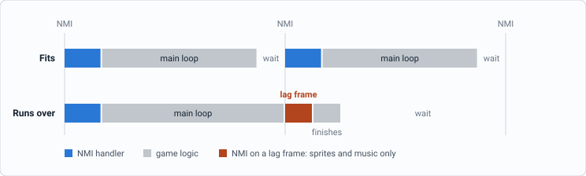
</picture>

*In the original, the NMI handler took about 5,060 cycles, leaving about 24,700 for the main loop. Game steps that ran over on the test routes needed 27,900 cycles of game logic on average, and a room entry needed about 82,400, nearly three frames.*

## The cartridge, unchanged

The work keeps Metroid's own board: 128K of program ROM in eight 16K banks, an MMC1 mapper that switches one bank into `$8000-$BFFF` while bank 7 stays fixed at `$C000-$FFFF`, 8K of work RAM at `$6000`, and RAM for graphics. During play the current area's bank is switched in (banks 1 to 5: Brinstar, Norfair, Tourian, Kraid's lair, Ridley's hideout). Bank 0 holds the title code and bank 6 holds graphics.

The fixed bank, where all the code that runs everywhere has to live, was already full. Every byte of faster code had to come from space found somewhere on the same chips. The second half of this document is about where it came from.

## Measuring the same game twice

Comparing the two by playing them is unreliable, because a faster game reacts to input at different moments and soon plays out differently. So the original and the new game start from the same saved moment and receive the same controller input at each step of the game's own loop, not at each video frame. The faster one then plays exactly the same game in fewer frames. Lag frames are counted when the NMI finds the game unfinished.

The eight test routes run 2,500 game steps each, mostly where slowdown is worst. Locations are Metroid's own map coordinates in hex, column then row: Ridley's hideout `0E,19` is the room in map column `$0E`, row `$19`.

## Where the time went

Two different problems cause the slowdown. In busy rooms, ordinary frames carry too much work: drawing many sprites, running enemies and checking every enemy against every shot. And at every room entry, the game draws the whole new room into a buffer in one go, which took about 52,000 cycles on its own.

<p>
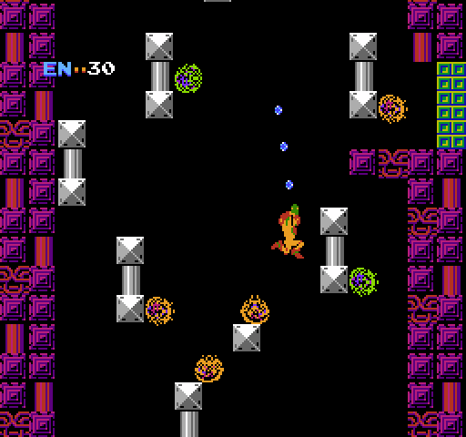
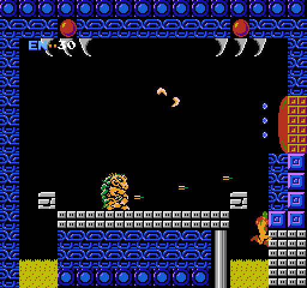
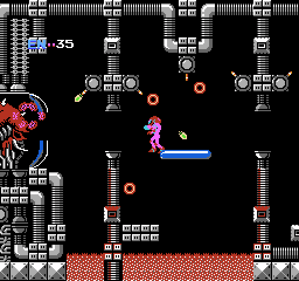
</p>

- Ridley's hideout `0E,1A`: 6 enemies, 3 shots, 46 hardware sprites
- Kraid's lair `08,1D`: Kraid and his 5 spikes (each its own enemy), 3 shots, 45 hardware sprites
- Mother Brain's chamber `02,0B`: 3 Rinkas, 2 cannon shots, 44 hardware sprites

*Busy moments captured in the original. In the Kraid room the original slowed down on almost half of all game steps (47.7%). In the Mother Brain fight, the stretch of the chamber leading up to her (screens `04,0B` and `03,0B`) lost 44% and 39% of their frames to slowdown; the whole fight took 9,601 frames, 2,302 of them lag frames. Played the same way now, it takes 7,302 frames with 3 lag frames.*

**One busy frame, before and after** · Average cycles in the 5,396 game steps that ran over budget in the original, compared with the same game steps now

<picture>
  <source media="(prefers-color-scheme: dark)" srcset="images/02-busy-frame-cycles-dark.svg">
  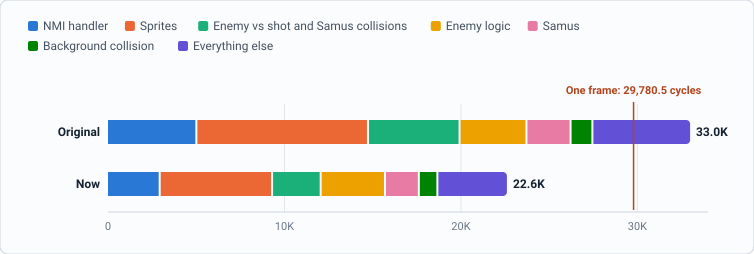
</picture>

<details>
<summary>Show the numbers</summary>

| Part of the frame | Original | Now |
| --- | ---: | ---: |
| NMI handler | 5,063 | 2,986 |
| Sprites | 9,726 | 6,369 |
| Enemy vs shot and Samus collisions | 5,190 | 2,753 |
| Enemy logic and movement | 3,789 | 3,645 |
| Samus (incl. standing on frozen enemies) | 2,501 | 1,918 |
| Background collision | 1,236 | 1,050 |
| Everything else (status bar, sprite list, shots, doors, blasted blocks…) | 5,482 | 3,884 |
| **Total** | **32,987** | **22,605** |

</details>

*The NMI bar is the handler's average cost per frame; the rest is the main loop's work in those game steps. Enemy logic barely changed: most of it is per-area code in the level banks, which have no room for new code.*

## What changed

The game makes every decision it made before and reaches the same result each time. The speed comes from doing the same work with fewer instructions, from answering a question early when the answer is already certain, from skipping stores that would be overwritten anyway, and from laying data out so the CPU can reach it directly.

The code comparisons below are trimmed to the part that matters, with labels added. Cycle counts are for the common case and come from the 6502's instruction timings; the totals in the results are measured.

### The music engine, ten times a frame

The sound engine runs inside the NMI handler, so its cost comes out of every frame, lag frames included. One small routine at `$B4BD`, part of the sound code that banks 0 to 5 all carry, runs once for each group of sound channels, about ten times a frame. Each time, it copies five bytes describing that group from a table, then looks through the group's request byte for a sound effect or song waiting to start. Almost always, nothing is waiting.

The original copies the bytes through a pointer in a loop, then finds the first request bit by shifting the request byte in memory, one bit at a time, eight times when there is none, and puts the byte back afterward. The rewrite reads the five bytes directly, and when the request byte is zero, which is the usual case, it returns at once with the registers and flags exactly as the original left them. Only when something is waiting does it scan, and then in a register instead of in memory.

**Original, `$B4BD`** · about 270 cycles per call

```asm
        STA $064D       ; request bits
        STX $E4         ; pointer to this group's
        LDY #$B2        ;  5-byte table entry
        STY $E5
        LDY #$00
copy:   LDA ($E4),Y     ; 4 bytes through the pointer
        STA $00E0,Y
        INY
        TYA
        CMP #$04
        BNE copy        ; 19 cycles x 4
        LDA ($E4),Y
        STA $065C
        LDY #$00
        LDA $064D
        PHA
scan:   ASL $064D       ; shift the byte in memory
        BCS found
        INY
        INY
        TYA
        CMP #$10
        BNE scan        ; 19 cycles x 8 when idle
        PLA
        STA $064D       ; put the byte back
        RTS             ; $B4EE
```

**Now, same address** · 69 cycles per call

```asm
        STA $064D
        STX $E4         ; ($E4/$E5 left as the
        LDA #$B2        ;  original leaves them)
        STA $E5
        LDA $B200,X     ; the 5 bytes, read directly
        STA $E0
        LDA $B201,X
        STA $E1
        LDA $B202,X
        STA $E2
        LDA $B203,X
        STA $E3
        LDA $B204,X
        STA $065C
        LDY #$00
        LDA $064D
        BEQ none        ; nothing waiting: done
        BNE scan
none:   LDY #$10        ; Y, A and flags exactly
        LDA #$00        ;  as the original's exit
        SEC
        RTS
scan:   PHA             ; rare: scan in a register,
sl:     ASL A           ;  tail at $BFA0 in the
        BCS found       ;  bank's spare bytes
        INY
        INY
        BNE sl
```

One detail mattered: the sound tables use the old routine's final `RTS` at `$B4EE` as a do-nothing handler, so the new layout keeps an `RTS` at exactly that address. The rarely used "request found" tail moved into spare bytes at the end of the bank.

> The routine fell from **268 to 74 cycles per call**, 2,673 to 727 cycles a frame.

### Reading the controllers

The NMI handler also reads both controllers every frame, eight buttons each, one bit per read of `$4016` or `$4017`. Metroid accepts a button from either bit 0 (the controller port) or bit 1 (the Famicom's expansion port), so each read is ORed down to one bit. The original keeps the result byte in A, so for every button it parks A on the stack, works on the new bit, and pulls A back. The rewrite builds the result in a zero-page byte instead, which the original overwrites a few instructions later anyway, and gets the OR of the two bits from a single compare.

**Original, `$C228`** · 28 cycles a button

```asm
        LDY #$08
bit:    PHA             ; park the result
        LDA $4016,X     ; read one button
        STA $00
        LSR A
        ORA $00         ; bit 0 OR bit 1
        LSR A           ; into the carry
        PLA             ; get the result back
        ROL A           ; shift the button in
        DEY
        BNE bit
```

**Now** · 18 cycles a button

```asm
        LDY #$08
bit:    LDA $4016,X     ; read one button
        AND #$03
        CMP #$01        ; carry = bit 0 OR bit 1
        ROL $00         ; shift it into $00
        DEY
        BNE bit
        LDA $00         ; result in A, as before
```

> Controller reading fell from **611 to 461 cycles a frame**. Together with the sound routine, the NMI handler fell from **5,063 to 2,986 cycles**: about 2,000 more cycles for the main loop in every frame. In the busy frames above, that alone covers two thirds of the average overrun.

### Drawing sprites with one index

Samus and the enemies are built from 8×8 hardware sprites. Each animation frame is a short stream of bytes: mostly tile numbers, one per sprite, with a few control bytes mixed in. A separate placement table gives each sprite's (y, x) offset from the object's position, stored as interleaved pairs. To draw a frame, the game walks the two side by side and writes four bytes per sprite into the sprite list: y, tile, attributes, x.

**Samus is eight sprites** · From a busy frame in Ridley's hideout, enlarged 8×, with each hardware sprite outlined

<picture>
  <source media="(prefers-color-scheme: dark)" srcset="images/03-samus-sprites-dark.svg">
  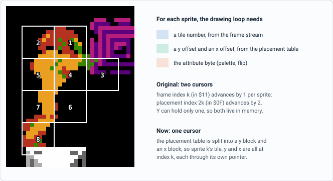
</picture>

*A frame of Samus running is 8 sprites; a busy frame has around 45 on screen, and the game rebuilds the whole list every frame. Whatever the loop spends per sprite is spent tens of times a frame.*

Why a new data layout saves so much: the 6502 has one register, Y, for indirect indexed loads such as `LDA ($00),Y`. In the original, the tile stream and the placement table advance at different rates, one byte and two bytes per sprite. So neither index can stay in Y. Both live in zero page, and every sprite reloads Y twice from them and increments them in memory three times. On top of that, each placement byte goes through a subroutine that tests for explosion data and for flipping, checks whose answers never change within a frame, and the attribute byte is recomputed for every sprite though it changes only at a control byte.

The build re-lays each bank's placement tables: all the y offsets first, then all the x offsets, with the frame pointers adjusted to match. Now one index reaches the tile, the y offset and the x offset of the same sprite, and stays in Y the whole time. The flip and explosion tests are made once per frame, by choosing one of four loops: no flip, horizontal flip, vertical flip, explosion. The attribute byte and the "minus one" the PPU needs for the y coordinate are worked out once per frame too.

**Original, per sprite, `$DEE6`** · about 164 cycles

```asm
write:  LDY $0F         ; placement index
        JSR YDisplacement ; explosion? flip? 28
        ADC $10
        STA $0200,X     ; sprite y
        DEC $0200,X     ; the PPU's y - 1
        INC $0F
        LDY $11         ; frame index
        LDA ($00),Y
        STA $0201,X     ; tile
        LDA $6B         ; attribute, every sprite
        ASL A
        ASL A
        AND #$40
        EOR $05
        STA $0202,X
        INC $11
        LDY $0F
        JSR XDisplacement ; same tests again: 29
        ADC $0E
        STA $0203,X     ; sprite x
        INC $0F
        INX
        INX
        INX
        INX
        LDY $11
        LDA ($00),Y     ; next frame byte
        CMP #$FC        ; tile or control byte?
        BCC write
```

**Now, no-flip loop** · 63 cycles

```asm
L00:    LDA ($00),Y     ; tile      (frame stream)
        CMP #$FC
        BCS control
        STA $0201,X
        LDA ($02),Y     ; y offset  (y block)
        ADC $0A         ; screen y - 1, per frame
        STA $0200,X
        LDA ($06),Y     ; x offset  (x block)
        CLC
        ADC $0B         ; screen x
        STA $0203,X
        LDA $0F         ; attribute, per frame
        STA $0202,X
        INY             ; one index for all three
        INX
        INX
        INX
        INX
        JMP L00
```

**Tables re-laid at build time** · Same bytes, new order, so one index reaches everything a loop needs

<picture>
  <source media="(prefers-color-scheme: dark)" srcset="images/04-placement-tables-dark.svg">
  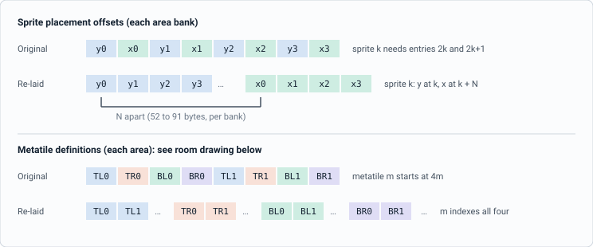
</picture>

*Both changes reorder the player's own ROM data when the patched ROM is built. Watching every memory read in the original confirmed that only the sprite and room-drawing code read these tables.*

> Per sprite, about 164 cycles became 63. Sprite work in busy frames fell from **9,726 to 6,369 cycles**; the rest is per-object setup, such as finding the frame and deciding whether the object is on screen.

### Collision checks that reject early

**Enemies against shots and Samus.** Every frame the game tests each of up to six enemies against each of Samus's three shot slots and against Samus herself: up to 24 pairs. Each object has a half-height and half-width (its radii). Two objects touch when the vertical distance between their centers is less than the sum of their vertical radii, and the same holds horizontally.

**The test, and where the time went** · Left: the geometry. Right: cycles for one pair, measured

<picture>
  <source media="(prefers-color-scheme: dark)" srcset="images/05-collision-test-dark.svg">
  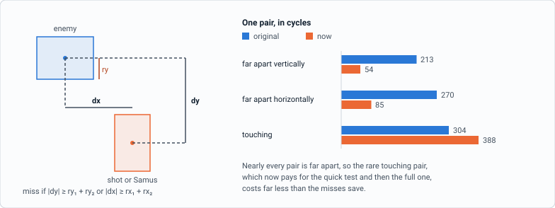
</picture>

The original runs its full test, `$F140`, for every pair. That routine calls three more subroutines to add the radii and fetch the second object's position, then works out both distances as 16-bit values, handling the case where the two objects are on different background name tables, before it compares anything. The new quick test computes the vertical distance with 8-bit arithmetic and rejects at once if it is too large, then does the same horizontally. It can only answer "miss" when the full test would also answer "miss". When the pair is close, it hands over to the original full test, so the hit handling that follows sees exactly the values it always did.

**Original: every pair** · 213 to 304 cycles

```asm
        JSR $F140       ; for each enemy x object

F140:   JSR $F1BF       ; radius sums, through
                        ;  2 more routines
        JSR $F186       ; the object's y, x,
                        ;  name table
        JMP $F1FA       ; full test:
F1FA:   LDA #$02
        STA $10
        AND $49         ; room scrolls which way?
        STA $03
        LDA $07
        SEC
        SBC $06         ; y distance, then
        STA $00         ;  16-bit sign and
        ...             ;  name-table cases
        CMP $04         ; against the radius sum
        BCS miss
        ...             ; then all of it for x
```

**Now: the quick test first** · 54 cycles for a vertical miss

```asm
        LDA $030C,Y     ; same name table?
        EOR $6AFB,X
        LSR A
        BCS seam        ; no: exact seam tests
        LDA $6AF5,X     ; y radius sum,
        CLC             ;  as the original adds it
        ADC $0301,Y
        STA $04
        LDA $07         ; |y distance|
        SEC
        SBC $030D,Y
        BCS +
        EOR #$FF
        ADC #$01
+       CMP $04
        BCS miss        ; too far apart
        ...             ; the same for x
        JMP $F140       ; close: the full test
miss:   RTS             ; carry set, as $F140
```

The loop around the test changed too. For each enemy, the original re-examined each shot's status (is it a bullet in flight, a missile, an exploding bomb?) and re-checked whether Samus could be hit at all (not invincible after a hit, not dying). The new loop answers those once per frame, before the enemy loop, keeps three shot flags and a Samus flag, and recomputes the Samus flag after any hit, since a hit can change it.

> In the busy frames, about 11 pairs a frame reach a test. The pair tests fell from **2,353 to 741 cycles a frame** (about 212 to 67 per pair), and the rest of the enemy-hit routine, loop included, from **2,834 to 2,012**.

**One frame's pairs, before and after** · Six enemy slots against three shot slots and Samus

<picture>
  <source media="(prefers-color-scheme: dark)" srcset="images/06-collision-pairs-dark.svg">
  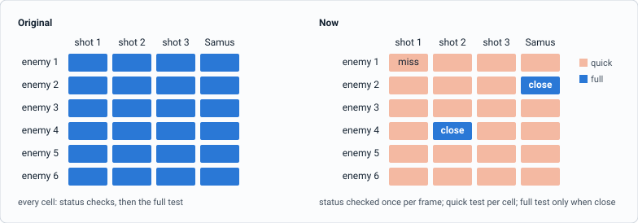
</picture>

*The two "close" cells are illustrative; in a typical busy frame only a handful of pairs out of 24 are close enough to need the full test.*

#### Pairs across the screen seam

The background is two name tables, the PPU's two screens of tiles. A room that scrolls vertically stacks them; one that scrolls horizontally puts them side by side. Each object records which name table it is on, and positions are 8-bit within it. When two objects are on different name tables, a plain 8-bit subtraction gives the wrong distance, which is why the original's full test works in 16 bits and, in vertical rooms, corrects for the 240-line height of a name table (y wraps at 256, but the screen is only 240 lines tall). The quick test handles these pairs with exact versions of its own: in a horizontal room the vertical test is unaffected and the horizontal distance gets its high byte from the name tables; in a vertical room, the vertical distance gets the 16-line correction.

These pairs are common in vertical shafts, where enemies sit on both name tables at once. Sending them to the full test instead cost 10 extra lag frames on the test routes.

**Two objects on different name tables, vertical room** · Positions are 0 to 239 within each name table

<picture>
  <source media="(prefers-color-scheme: dark)" srcset="images/07-seam-dark.svg">
  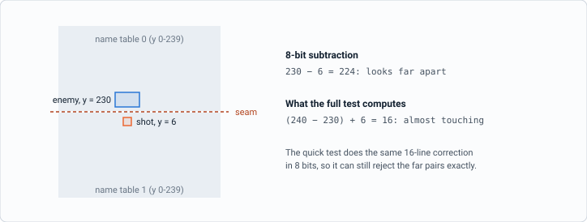
</picture>

**Standing on frozen enemies.** Samus can stand on enemies frozen by the ice beam, so every frame the game tests her against all six enemy slots. The new code first checks whether any enemy is frozen at all, a single compare against each slot's status, and returns at once if none is. For frozen ones it uses the same kind of quick rejection before the original test. The test runs two or three times a frame, and together those calls fell from **1,147 to 564 cycles** a frame.

**Walls and floors.** To test an object against the background, the game checks a line of tiles along one edge, for instance the tiles under Samus's feet. For every tile, the original rebuilt the room-buffer address from the pixel coordinates, then called the area's tile hook and the solid-tile test as subroutines. Consecutive tiles along an edge are neighbors in the buffer: 1 byte apart along a row, 32 bytes apart down a column. The new loop builds the address for the first tile and then just adds 1 or 32, rebuilding it only where the original's coordinate step wraps around the screen. The tile hook is called only in Tourian, the one area where it does anything; elsewhere it is a bare `RTS`. The solid test is inline.

**Original, per tile, `$E7DE`** · address rebuilt every tile

```asm
tile:   JSR $E96A       ; address from x and y:
                        ;  shifts, ORs, 63 cycles
        LDY #$00
        LDA ($04),Y     ; the tile
        CMP #$4E        ; door?
        BEQ door
        JSR $95C0       ; area hook (RTS but Tourian)
        JSR $D651       ; solid?
        BCC solid
        ...
        DEX
        BEQ done
        JSR $E98E       ; next x or y (+8)
        JMP tile
```

**Now, next tile** · address stepped

```asm
nb8:    LDA $06         ; stepping down?
        BEQ across
        CLC             ; y += 8
        ADC $02
        STA $02
        CMP #$F0        ; past the screen?
        BCC +
        JMP wrap        ; rare: the original's way
+       LDA $04         ; address += 32
        ADC #$20
        STA $04
        ...
across: ...             ; x += 8, address += 1
        LDY $23
        CPY #$03        ; Tourian? then the hook
        ...             ; solid test inline
```

> Collision work in busy frames: enemy hits **5,190 → 2,753**, Samus **2,501 → 1,918**, background **1,236 → 1,050** cycles. Background checks gain less because most of them read only one or two tiles before deciding.

### Drawing a room in less than half the time

When Samus goes through a door or scrolls into the next room, the game draws that room into one of two 1K buffers in work RAM, which are later copied to the PPU a column or row at a time as the screen scrolls. A room is described in ROM as a list of **structures**: floors, walls, pillars, pipes, runs of blocks. Each entry gives a position, a structure number and a palette. A structure is a few rows of **metatiles**, and a metatile is a 2×2 block of 8×8 tiles, 16 pixels square. Enemies, doors and items come after the structure list and are handled separately.

The original does it in two passes. First it fills the whole buffer: 960 name-table bytes set to the blank tile `$FF` and 64 attribute bytes set to the room's palette. Then, for each structure, for each row, for each metatile, it writes four tiles, and if the structure's palette differs from the room's, updates the attribute byte that covers the metatile.

**Ridley's hideout, room $15, as the drawer builds it** · Drawn from its room buffer: 15 rows of metatiles, 16 metatiles across

<picture>
  <source media="(prefers-color-scheme: dark)" srcset="images/08-room-15-drawer-dark.svg">
  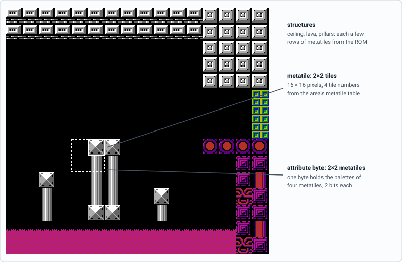
</picture>

#### Metatiles: split tables and a loop that only draws

Per metatile, the original checks that the pointer hasn't reached the attribute table, fetches the metatile number, multiplies it by four to find its entry in the metatile table, copies four tiles through two pointers and a position table, calls the attribute routine, calls a helper to add 2 to the pointer, and tests for the end of the screen line. About 210 cycles, of which only four loads and four stores are the actual drawing.

The new drawer moves everything that doesn't change within a row out of the loop. The build splits the metatile table into four tables, one per corner, so the metatile number itself indexes all four. The loop runs from work RAM so it can patch its own instructions: the four stores use absolute,X addressing with X as the position within a 256-byte page, and their page byte is patched once per row; the structure byte is read through a patched address; and the row is clipped at the edge of the screen once, before the loop, by computing where it stops.

**Original, per metatile, `$EF2B`** · about 210 cycles

```asm
meta:   LDA $01 ...     ; reached the attribute
                        ;  table? (12 cycles)
        INC $10
        LDY $10
        LDA ($35),Y     ; metatile number
        ASL A
        ASL A           ; x 4: its table entry
        STA $11
        LDX #$03
tile:   LDY $11
        LDA ($3F),Y     ; tile from the table
        INC $11
        LDY TilePos,X   ; $21 $20 $01 $00
        STA ($00),Y     ; into the room buffer
        DEX
        BPL tile        ; 28 cycles x 4
        JSR UpdateAttrib ; palette check
        LDY #$02
        JSR AddYToPtr00 ; pointer += 2
        LDA $00
        AND #$1F        ; end of the line?
        BNE +
        ...
+       DEC $0E
        BNE meta
```

**Now, in work RAM** · 58 cycles

```asm
Mt:     LDY $xxxx       ; metatile number
        INC Mt+1        ;  (address patched per
        BNE +           ;   row, stepped here)
        INC Mt+2
+       LDA TL,Y        ; four tables,
        STA $6000,X     ;  one index
        LDA TR,Y
        STA $6001,X     ; page byte patched
        LDA BL,Y        ;  once per row
        STA $6020,X
        LDA BR,Y
        STA $6021,X
        INX
        INX
        CPX #end        ; row end, clipped
        BNE Mt          ;  before the loop
        JMP RowEnd      ; or RowEndA: attributes
```

> Metatile work per room fell from **25,497 to 7,502 cycles** on average, over all 193 rooms.

#### Attributes once per row

Each attribute byte covers a 2×2 block of metatiles, 2 bits per metatile. When a structure's palette differs from the room's, the original updates the byte after every metatile: read it, clear that metatile's two bits, set the new ones, write it back. A row of metatiles always covers the top or the bottom half of each attribute block it crosses, so two neighboring metatiles in the row share a byte. The new drawer does the row's attribute bytes in one pass after its tiles, and combines each such pair into one read-modify-write. The result is identical because

```
(b AND M0 OR S0) AND M1 OR S1 = b AND (M0 AND M1) OR (S0 AND M1 OR S1)
```

For a pair, M0 AND M1 is `$F0` or `$0F`, a constant, and the combined palette bits are worked out once per structure.

> Attribute work per room fell from **7,063 to 1,804 cycles** on average.

**One attribute byte, two metatiles in a row** · Top-half pair shown; the bottom half uses bits 4-7

<picture>
  <source media="(prefers-color-scheme: dark)" srcset="images/09-attribute-pairs-dark.svg">
  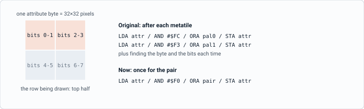
</picture>

#### Skipping rows nobody will see

The fill is the other big cost: 1,024 bytes at 11 cycles each in the original, every room. But in most rooms some rows are covered completely by structures, and those rows get filled with blanks only to be overwritten a moment later. They are almost always the floor and the ceiling: of the 858 rows that are fully covered across all 193 rooms, 797 are at the top or bottom of their room.

The new fill is a loop that stores to all 15 rows, plus the attribute table, for each of 64 positions, with the rows in the order 0, 14, 1, 13, 2, 12 and so on, from the outside in. The rows a room covers at the top and bottom then come first in the loop, and the fill skips them by entering the loop partway through. The entry point comes from a table built when the ROM is built, by drawing every room and noting which rows its structures fill: one byte per room.

**Original fill, `$F01C`** · 11 cycles a byte, 1,024 bytes

```asm
fill:   STA ($00),Y     ; $FF into the buffer
        DEY
        BNE fill        ; 256 bytes, then
        DEC $01         ;  the next page
        INX
        BNE fill
        ...             ; then 64 attribute bytes,
                        ;  same loop shape
```

**Now, buffer at `$6000`** · about 6 cycles a byte, fewer bytes

```asm
FA0:    STA $6000,Y     ; row 0   } room $15
        STA $6380,Y     ; row 14  } enters
        STA $6040,Y     ; row 1   } below
        STA $6340,Y     ; row 13  } these
        STA $6080,Y     ; row 2  <- entry
        STA $6300,Y     ; row 12
        ...             ; rows 3, 11 ... 7
        LDA PV
        STA $63C0,Y     ; attribute byte
        LDA #$FF
FAI:    INY
        CPY #$40        ; 64 positions
        BNE FA0         ; target patched per room
```

**The fill, outside in, on room $15** · Rows 0, 1, 13 and 14 are covered completely by the ceiling and the lava, so the loop is entered at its fifth store

<picture>
  <source media="(prefers-color-scheme: dark)" srcset="images/10-room-fill-order-dark.svg">
  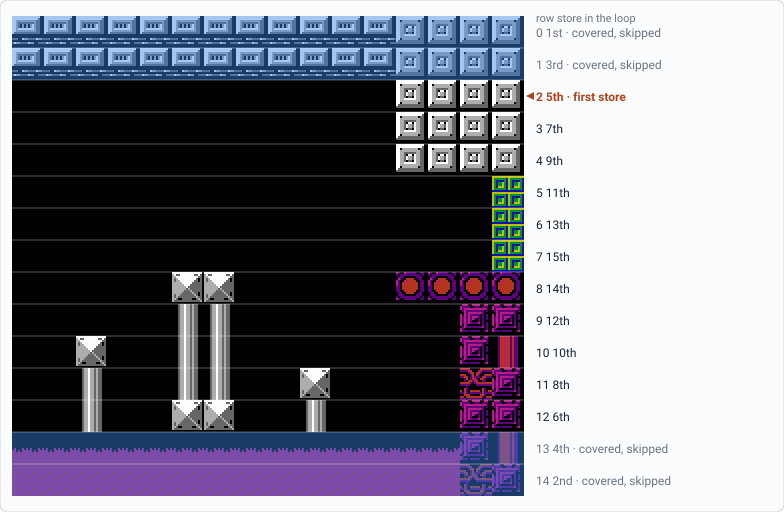
</picture>

*Blue rows are covered completely by structures. Each pass of the loop stores one byte to every row it runs, 64 passes in all, so entering at the 5th store removes 4 rows from every pass: 256 fewer stores for this room. Seven rooms are covered completely; for those only the attribute table is filled. The table can't go stale: the drawing depends only on the room number, the buffer, the area and its data, which was checked by drawing every room from randomized memory.*

> The fill per room fell from **12,080 to 5,011 cycles** on average.

#### The same end state

The original leaves values in a handful of zero-page bytes when it finishes, such as the buffer pointer and the last metatile's index. Rather than keeping them up to date for every row, the new drawer works out what the original would have left, once, at the end. Every room draws the same 1K image and leaves the same zero page and registers as the original. As it turns out, nothing in the game reads those leftover values (see "Keeping the game identical" below), but reproducing them costs little and keeps every comparison exact.

> Drawing a room averages **22,262 cycles instead of 51,801**, and the slowest room fell from 117,239 to 41,920. A room-entry game step fell from about 82,400 cycles to 44,400: one lag frame instead of two or three.

**Drawing one room, by phase** · Average cycles over all 193 rooms

<picture>
  <source media="(prefers-color-scheme: dark)" srcset="images/11-room-draw-phases-dark.svg">
  
</picture>

<details>
<summary>Show the numbers</summary>

| Phase | Original | Now |
| --- | ---: | ---: |
| Fill (name table and attributes) | 12,080 | 5,011 |
| Metatiles (incl. pointer helpers) | 25,497 | 7,502 |
| Attributes | 7,063 | 1,804 |
| Row setup | 3,857 | 5,628 |
| Structures and setup | 3,304 | 2,317 |
| **Total** | **51,801** | **22,262** |

</details>

*Row setup is the one phase that grew. Clipping the row, setting the store page and pointing the loop at the structure bytes now happen once per row, which is what lets the per-metatile loop be so short.*

### The rest of the frame

- **Name-table updates** (`$E5C2`): when the screen scrolls, the game queues a column or row of tiles for the PPU, one subroutine call per byte. The new code copies all but the last byte in a tight loop, then lets the original loop handle the last one, so every exit is unchanged. 1,733 cycles per call became 1,259; in the busy frames, **160 → 73 cycles a frame**.
- **Clearing unused sprites** (`$CB66`): the original hides each unused sprite slot in a loop. Now the game jumps into an unrolled run of 64 stores in work RAM, at the point that clears exactly the unused slots. **621 → 133 cycles a frame**.
- **The status bar** (`$E0C7`): the energy and missile display's sprites are copied by an unrolled run of immediate loads and stores instead of a table loop. The whole status-bar routine: **883 → 490 cycles a frame**.
- **Choosing handlers**: the game's generic dispatcher finds its jump table through the return address on the stack. For enemies and projectiles, it is replaced by a jump whose target is patched directly, and dispatches that would only return are skipped. The generic dispatcher now runs about 8 times a frame instead of 20: **1,183 → 815 cycles a frame** for dispatching.
- **Blasted blocks**: the loop over blocks that Samus has shot away runs from work RAM and skips empty slots without calling anything. **658 → 353 cycles a frame**.

> Frame figures above are averages over the 5,396 busy game steps. "Everything else" in those frames: **5,482 → 3,884 cycles**.

## Finding room on a full cartridge

None of this would fit in the space the original leaves free, which is almost none. The fixed bank is full of code, the five area banks are full of level data and their own code, and work RAM holds the two room buffers, the world map and the game's state. The new code came from seven places.

### 1. Code that no longer runs

Every routine that was replaced left its old body behind in the fixed bank. Keeping only the few bytes that other code still reads or jumps to, that is 1,904 bytes in 18 pieces. Three of them came from the graphics loader: its 203-byte table of graphics blocks (`$C6E0`) and the loader itself moved to bank 6, and 265 bytes of code that called the loader once per block (`$C5D7`) became short lists of block numbers in bank 6. Another 192 bytes (`$CA35`) are routines for a saved-game feature, left over from the disk version, that the cartridge game never calls.

### 2. Bank 6, the graphics bank

Bank 6 is switched in only while graphics are being loaded. The graphics loader's own table lists every block it copies (bank, source, length), and the blocks it lists from bank 6 cover the whole bank except five gaps, which the disassembly also marks as garbage: 3.3K at `$8AA0`, `$98A0`, `$99C0`, `$B4B0` and `$B8C0`. They now hold the relocated graphics table and load lists, the per-area room-fill tables, and a 1.9K image of all the code that runs from RAM, together with the loader that copies it.

### 3. Work RAM the game leaves unused

Three stretches of the 8K work RAM are never used by the original: `$6C74-$6DFF`, `$6F20-$6FFF` and `$7400-$77EF`, about 1.6K. Three bytes of it, `$6F20`, `$6F30` and `$6F40`, hold the collision loop's per-frame shot flags, so the code around them comes in 15-byte pieces. Code that patches itself has to live in RAM, because ROM cannot be written. How "never used" was established is described under "Keeping the game identical".

### 4. The title screen's sprite memory

`$6E00-$6F1F` holds the stars and sprites of the title screen and is unused during play. During play it holds the room drawer's structure loop and attribute pass.

### 5. The bottom of the stack page

Metroid keeps a few variables at `$0100-$010F` and its stack grows down from `$01FF`. A static analysis of every call path shows the stack can never reach below `$01CA`, and in all the test runs it never went below `$01D9`. The 128 bytes at `$0120-$019F` hold the room drawer's row setup.

### 6. Padding at the end of every bank

Each switchable bank ends with a small reset stub at `$BFB0` and the interrupt vectors at `$BFFA`, with 16 unused bytes before the stub (`$BFA0-$BFAF`) and 26 between the stub and the vectors (`$BFE0-$BFF9`), all zero in the original. Three small read-only pieces live there, written identically into all seven switchable banks so they are present whichever bank is mapped: the sound routine's tail, the explosion-rotation code, and an eight-byte table of each bank's distance between its y and x placement blocks.

### 7. Rewriting in place

The sound routine keeps its own address and length in banks 0 to 5, so nothing that calls it had to change.

Code in RAM has to be put there. Whenever a set of graphics is loaded, the loader in bank 6 copies the RAM code into place, which happens before any of it is needed: at power-on, at the start of a game and on entering each area. Pieces bound for the title sprite memory or the stack page are copied only in play mode, so the title screen keeps its data. The loader also copies the current area's room-fill table and tags it with that area's bank number; if the tag ever fails to match, the room drawer simply fills every row.

Fitting about 70 pieces of code into about 30 free regions is a packing problem with rules: some pieces must sit in the fixed bank, self-patching pieces must sit in RAM, and the play-mode-only regions can hold only room-drawing code. The final layout has 183 bytes to spare.

**Where the new code lives** · CPU address space during play, not to scale; the two strips are to scale within their banks

<picture>
  <source media="(prefers-color-scheme: dark)" srcset="images/12-memory-map-dark.svg">
  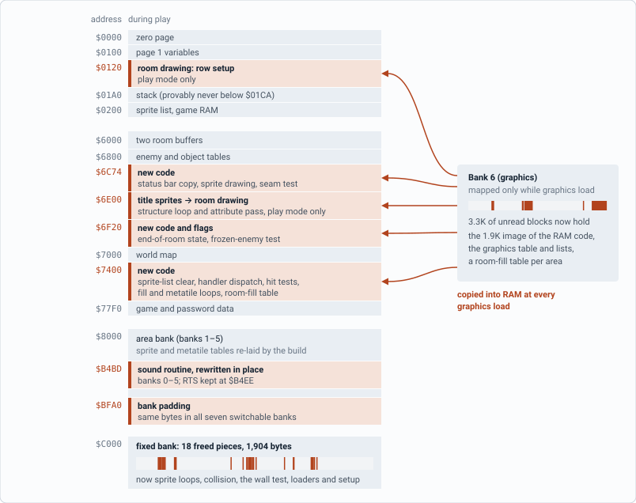
</picture>

*Orange marks new code. In the fixed bank the freed pieces are scattered where the replaced routines used to be; in bank 6 the five reclaimed blocks are shown at their addresses.*

| What | In the original | Now |
| --- | --- | --- |
| Graphics table (203 bytes) | Fixed bank, `$C6E0` | Bank 6, `$B8C0` |
| Graphics load sequences | Fixed bank, `$C5D7`, as code | Bank 6, `$BF00`, as lists of block numbers |
| Room fill | Fixed bank, `$EFF8` | Work RAM, one loop per room buffer, entered by table |
| Metatile loop | Fixed bank, `$EF2B` | Work RAM, self-patching |
| Structure row setup | Fixed bank, `$EF13` | Stack page, `$0120` |
| Structure loop and attributes | Fixed bank, `$EA60`, `$EF9E` | Title sprite memory, `$6E00` |
| Sound request routine | Banks 0–5, `$B4BD` | Same address, rewritten; tail at `$BFA0` in every bank |
| Controller read | Fixed bank, `$C228` | Same address, rewritten |
| Sprite drawing | Fixed bank, `$DD8B-$E048` | Fixed bank (freed space) and work RAM |
| Enemy hit loop | Fixed bank, `$F09D` | Fixed bank (freed space), quick tests in work RAM |
| Samus vs frozen enemies | Fixed bank, `$D976` | Work RAM `$6FB0`, quick tests in the fixed bank (freed space) |
| Wall and floor tile loop | Fixed bank, `$E7DE` | Fixed bank, `$EF15` (the old room drawer's space) |
| Room-fill tables | (new) | Bank 6, copied to work RAM `$74FE` for the current area |

## Keeping the game identical

The rule throughout: no check is skipped or approximated. A quick test may only reject what the full test would reject, and every value the game later reads has to come out the same. Wherever the input space was small enough, that was tested exhaustively or proven; elsewhere it was tested on long runs.

#### Tested exhaustively

- **Every room.** All 193 rooms were drawn into both room buffers and compared with the original: the same 1K image, every zero-page byte, the registers and the exit point. Then each was drawn six more times with all other RAM and work RAM randomized. The image never changed, in either ROM, which shows the drawer reads nothing but the room number, the buffer, the current bank and the area's pointer block, so the per-room fill table always applies.
- **Collision quick tests.** A small 6502 emulator written in C ran the actual code of both ROMs. For the enemy test and the frozen-enemy test, each axis was swept over every pair of positions and every radius sum, in all 16 combinations of room direction, name tables and scroll register: 537 million cases each. Another billion cases each had every input random at once. The quick tests and the original agreed every time, and the enemy test turns out to reject exactly the pairs the original rejects, no more and no fewer.
- **Stack depth.** A static analysis followed every call path from the reset and interrupt vectors, through every jump table, for the original and the new ROM: the stack can never go below `$01CA` (30 bytes for the deepest main-loop path, 21 for the interrupt handler, 3 for the interrupt). The new code in the stack page ends at `$019F`.
- **Stores into reclaimed RAM.** Every store instruction in the original that could reach the reclaimed regions was found by scanning all 128K, and each one's index or pointer was traced: all of them are bounded outside those regions, apart from the title screen's own sprite memory. The closest is a Tourian table that ends at `$6C73`, one byte before the reclaimed space.

#### Tested on long runs

- **Every rewritten routine** was called from thousands of random game states on both ROMs with all of RAM and work RAM compared afterward: 30,000 sprite calls, and 5,000 to 15,000 calls each for collisions, walls and floors, the sound routine, the controllers and name-table updates.
- **Lockstep play.** The original and the new ROM ran side by side through 14 room routes of 900 game steps each and the whole Mother Brain fight, with all memory compared after every step, scratch bytes and code areas aside. There were no differences.
- **Reclaimed RAM in play.** The original ran for 282,000 frames under a watch on every reclaimed byte: the title, all eight routes, every one of the 193 rooms, and the Mother Brain fight. Nothing read or wrote reclaimed work RAM or the reclaimed part of the stack page during play.
- **Leftover zero page.** Two copies of the original ran in lockstep, and in one, the values the room drawer leaves in zero page were scrambled every time it finished: 940 room draws, 251,600 comparisons, no difference ever appeared. Scrambling the same bytes in the middle of a draw shows up within one game step, so the test does detect real use.
- **Power-on.** Fourteen random power-on RAM patterns each reach gameplay.

This checking also caught a mistake made during development. As first written, the quick test for an enemy and a shot on opposite sides of the screen seam in horizontal rooms took the enemy's side from the enemy's own name-table bit, which is right only when the screen's base name table is the second one. With the base on the first, a close pair could be rejected and a hit missed. The test now reads the side from the same value the full test uses, and the exhaustive sweep above covers it.

## Results

On the eight test routes, lag frames fell from 5,586 to 74. Ordinary game steps no longer cause slowdown at all; what remains is one frame per room entry, plus one extra on a single entry.

| Route (2,500 game steps each) | Rooms entered | Original lag frames | Now |
| --- | ---: | ---: | ---: |
| Brinstar, from the start | 9 | 18 of 2,517 (0.7%) | 9 (0.4%) |
| Ridley's hideout `0E,19`, left and right | 8 | 456 of 2,955 (15.4%) | 8 (0.3%) |
| Ridley's hideout `0E,19`, vertical shaft | 6 | 158 of 2,657 (5.9%) | 6 (0.2%) |
| Norfair `1B,0C`, left and right | 3 | 217 of 2,716 (8.0%) | 3 (0.1%) |
| Kraid's lair `07,1C`, heading left | 1 | 764 of 3,263 (23.4%) | 1 (0.04%) |
| Ridley's hideout `1B,13`, left and right | 41 | 1,079 of 3,578 (30.2%) | 42 (1.7%) |
| Ridley's hideout `1D,15`, left and right | 4 | 611 of 3,110 (19.6%) | 4 (0.2%) |
| Kraid's lair `08,1D`, left and right | 1 | 2,283 of 4,782 (47.7%) | 1 (0.04%) |
| **All routes** | **73** | **5,586 of 25,578 (21.8%)** | **74 of 20,066 (0.37%)** |

**Mother Brain.** A scripted fight from the corridor outside her chamber until she is destroyed takes 7,302 frames instead of 9,601, with 3 lag frames instead of 2,302. In the original, 44% of frames were lag frames in the first screen of the chamber, 39% in the second and 8% in hers; now no part of the fight is above 0.1%.

**In a second emulator.** In Mesen, with its own scripted 30-second runs, Ridley's hideout went from 366 lag frames to 9, its vertical shaft from 168 to 6, Norfair from 253 to 6 and Kraid's lair from 13 to 1. What remains is about one lag frame per room entered.

### What is left

Each room entry still costs one lag frame. Drawing a room takes about 22,000 cycles, and the rest of that game step takes 15,000 to 20,000 more, which is more than one frame holds. One entry, into a Ridley room with many enemies on screen, still costs two: that step needs about 600 cycles more than it has, and the code that would save them needs about 25 bytes the layout no longer has.

## What didn't make it

- **Drawing rooms a column at a time.** Drawing each column only as it scrolls into view spreads the cost over many frames, but every column has to walk through every structure in the room again. On this cartridge, with no room for per-room lookup tables, it was slower than drawing the room once.
- **Dropping the seam tests to make room.** Removing either quick test for pairs across the screen seam, the one in the enemy-hit loop for vertical rooms or the one in the frozen-enemy test, freed space but cost 10 and 4 extra lag frames on the test routes, so both stayed.

## Building from source

The patches are made by `build.py` from your own copy of the game. It needs Python 3 and nothing else.

```bash
python build.py "Metroid (USA).nes"
```

This writes `Metroid (USA) - Lag Fix 1.0.nes`, keeping your file's header. The script checks the input (ROM CRC32 `70080810`) and writes nothing unless the result matches the release (ROM CRC32 `B55720CE`); add `--allow-mismatch` after changing the sources. `--bps DIR` also writes both release patches into `DIR`.

| Path | Contents |
|---|---|
| `build.py` | Checks the input, runs the build, writes the ROM and, with `--bps`, the patches |
| `asm/` | The new 6502 code, one file per change |
| `lib/stage1.py`, `lib/stage2.py` | Assemble the code, place it in the free space, and rearrange the game's tables |
| `lib/layout.py` | Where each piece of code goes; `--repack` searches for a new layout after a source change |
| `lib/title.py` | The LAG FIX 1.0 line on the title screen |
| `lib/bps.py` | Writes patches that copy every byte of the game from your ROM instead of storing it |
| `lib/asm6502.py`, `lib/roomdraw.py`, `lib/frames.py` | A small 6502 assembler, the game's room drawing in Python, and a reader for its sprite frames |
| `tools/check_sources.py` | Lists any source lines that reproduce bytes of the original game |

No part of the game is in these files. Where the new code keeps instructions of the original, the source says `.rom $ADDR,n`, and the assembler copies those bytes from your ROM. Tables the build moves or rearranges are read from your ROM too.

---

Cycle counts are NTSC CPU cycles. Lag frames are frames in which the NMI found the main loop unfinished. All measurements were taken on the released game code, before the title-screen line was added (it changes nothing in play), against Metroid (USA), ROM CRC32 `70080810`. Screenshots are from the original ROM, rendered by the test emulator.

Addresses are CPU addresses as seen during play; bank numbers count from 0.
